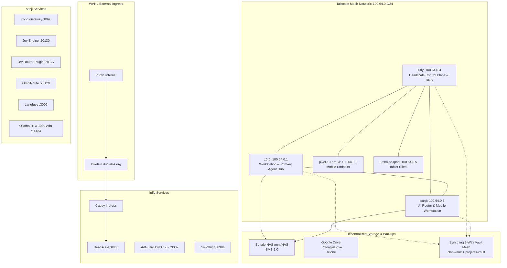

# 📚 Nix Flake Pirates (NFP) Documentation Index

Comprehensive navigational index and architecture registry for the Nix Flake Pirates infrastructure.

---

## 🗺️ Fleet Topology & Mesh Architecture

---

## 📑 Core Documentation Categories

### 1. Fleet & Network Infrastructure
- [Herdr Fleet Management](file:///home/t0psh31f/Clan/NFP/layers/00-cyberia/01-docs/herdr-fleet.md) — Multi-node persistent agent workspaces across `sanji`, `luffy`, and `z0r0`.
- [Fleet Provisioning Guide](file:///home/t0psh31f/Clan/NFP/layers/00-cyberia/01-docs/FLEET_PROVISIONING.md) — Zero-touch live installer & bootstrapping.
- [Network Setup Guide](file:///home/t0psh31f/Clan/NFP/layers/00-cyberia/01-docs/network-setup-guide.md) — Headscale control plane, AdGuard Home DNS, and Caddy reverse proxy.
- [Fleet Port Registry](file:///home/t0psh31f/Clan/NFP/layers/00-cyberia/01-docs/ports.md) — Complete TCP/UDP port mapping authority.
- [Live Installer Deployment](file:///home/t0psh31f/Clan/NFP/layers/00-cyberia/01-docs/deploy-from-live.md) — Rescue, recovery, and offline deployment.
- [General Deployment Guide](file:///home/t0psh31f/Clan/NFP/layers/00-cyberia/01-docs/deployment.md) — Fleet rollout procedures.

### 2. Architecture & Design Patterns
- [Desktop Environments & Theming](file:///home/t0psh31f/Clan/NFP/layers/00-cyberia/01-docs/desktop-environments.md) — Unified Layer 30 environments, Layer 40 pure compositors, and Quickshell Rise live-wire effects.
- [Dendritic Coding Patterns](file:///home/t0psh31f/Clan/NFP/layers/00-cyberia/01-docs/Patterns.md) — Rules for `mkDendriticModule`, nested attribute sets, and clean layer separation.
- [Profile Tag Architecture](file:///home/t0psh31f/Clan/NFP/layers/00-cyberia/01-docs/Profile-Architecture.md) — Declarative tags (`desktop`, `server`, `ai-router`) mapping to profiles.
- [Machine Tag Matrix](file:///home/t0psh31f/Clan/NFP/layers/00-cyberia/01-docs/tag-matrix.md) — Inventory of all machines and applied tags.
- [Service Contract System](file:///home/t0psh31f/Clan/NFP/layers/00-cyberia/01-docs/services.md) — `nfp.services.*` declarative contracts.
- [NixOS Anti-Patterns](file:///home/t0psh31f/Clan/NFP/layers/00-cyberia/01-docs/nixos-anti-patterns.md) — Anti-pattern avoidance guide.

### 3. AI Agent Swarm & Infrastructure
- [Jev Oversight via Pi Durable Agents](file:///home/t0psh31f/Clan/NFP/layers/00-cyberia/01-docs/jev-pi-oversight.md) — MCP tools, Herdr persistent watchdog, and Langfuse telemetry.
- [Agent Layer Hierarchy](file:///home/t0psh31f/Clan/NFP/layers/00-cyberia/01-docs/agent-layers.md) — Structure of layers 70 through 79 (70-jev, 71-harness, ..., 79-skills).
- [AI Stack Reference](file:///home/t0psh31f/Clan/NFP/layers/00-cyberia/01-docs/ai-stack.md) — Local inference, neural voice (GLaDOS), vision, and routing.
- [AI Agents Catalog](file:///home/t0psh31f/Clan/NFP/layers/00-cyberia/01-docs/ai-agents.md) — Active agents, tool sets, and capabilities.
- [Hermes Agent Architecture](file:///home/t0psh31f/Clan/NFP/layers/00-cyberia/01-docs/hermes-agent.md) — Hermes Gateway, workspace, and sandbox.
- [Jev System-1 Decision Engine](file:///home/t0psh31f/Clan/NFP/layers/00-cyberia/01-docs/jev.md) — Deterministic discriminative routing & triage.
- [Jev AI Router Performance & Hardware Report](file:///home/t0psh31f/Clan/NFP/layers/00-cyberia/01-docs/jev-router-report.md) — Sanji benchmark results, Kong gateway latencies, and RTX 1000 Ada inference profiles.
- [Agent Onboarding Guide](file:///home/t0psh31f/Clan/NFP/layers/00-cyberia/01-docs/agent-onboarding.md) — Instructions for autonomous agent initialization.
- [Agentbox Sandbox Instructions](file:///home/t0psh31f/Clan/NFP/layers/00-cyberia/01-docs/agentbox-instructions.md) — Containerized execution boundaries.
- [Memory Platform Audit](file:///home/t0psh31f/Clan/NFP/layers/00-cyberia/01-docs/memory-platform-audit.md) — EverOS, Honcho, and brain-service analysis.

### 4. Observability & Monitoring
- [Observability Coverage Matrix](file:///home/t0psh31f/Clan/NFP/layers/00-cyberia/01-docs/observability-coverage-matrix.md) — Prometheus metrics, Langfuse traces, and Loki logs.
- [Fleet Monitoring](file:///home/t0psh31f/Clan/NFP/layers/00-cyberia/01-docs/monitoring.md) — Netdata, Prometheus, and Grafana dash configs.

### 5. Desktop, TUI & Tools
- [Desktop Environments & Theming](file:///home/t0psh31f/Clan/NFP/layers/00-cyberia/01-docs/desktop-environments.md) — Layer 30 / 40 decoupling and Quickshell Rise bar customization.
- [Yazelix Terminal Suite](file:///home/t0psh31f/Clan/NFP/layers/00-cyberia/01-docs/yazelix_guide.md) — Yazi, Helix, and Zellij integrated desktop workflow.
- [Vicinae Launcher Secrets](file:///home/t0psh31f/Clan/NFP/layers/00-cyberia/01-docs/vicinae-secrets.md) — Secure key management for quick actions.
- [Post-Rebuild Setup](file:///home/t0psh31f/Clan/NFP/layers/00-cyberia/01-docs/post-rebuild-setup.md) — First boot and post-rebuild verification steps.
