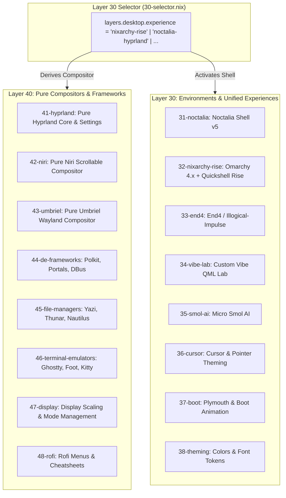

# 🖥️ Desktop Environments Architecture & Theming Guide

Comprehensive architecture documentation for Layer 30 (Environments & Unified Experiences) and Layer 40 (Pure Compositors & Frameworks) in the Nix Flake Pirates (NFP) infrastructure.

---

## 🏛️ Layer Separation & Requisition Philosophy

The desktop stack enforces strict dendritic boundaries and zero bleed between compositors and thematic shell environments:



### 1. Compositor Decoupling Rules
- **Pure Compositors (Layer 40)**: Never hardcode window borders, blur shaders, active experience configs, or vendor-specific hacks. Shaders like `vibrancy.frag` belong exclusively to the experience that created them (e.g., `31-noctalia`).
- **Dynamic Derivation**: `layers/30-environments/30-selector.nix` dynamically inspects `layers.desktop.experience` and derives `layers.desktop.compositor` (`hyprland`, `niri`, `umbriel`, or `none`).
- **Tag Profile Purity**: Profiles in `layers/90-profiles/tags/desktop.nix` must NEVER enable a compositor directly (e.g. `hyprland.enable = true` is strictly prohibited). They only enable `layers.desktop.enable = true`.

---

## ⚡ Quickshell Rise & Green Animated Live Wire Bar

Nixarchy Rise (`layers/30-environments/32-nixarchy-rise/default.nix`) deploys **HANCORE Quickshell Rise** (`github:HANCORE-linux/quickshell-dots`) on top of Omarchy 4.x.

### 1. The Live Wire Electric Arc Effect
Quickshell Rise contains a built-in QML particle engine (`versions/V1/modules/ParticleStream.qml`) that activates when bar splits/gaps are enabled. It provides 8 distinct visual animation modes:

| Mode | Name | Description |
|---|---|---|
| `0` | **Off** | Static bar without particle simulation |
| `1` | **Stream** | Smooth laminar particle flow through gaps |
| `2` | **Surge** | Pulsing kinetic particle wave bursts |
| `3` | **Bolt** | **Live Electric Wire**: Continuous current waves charge the field, discharging as high-intensity electric lightning arcs and flashes across the gap |
| `4` | **Bolt 2** | Rapid multi-stage lightning and electrical discharging |
| `5` | **Stream 2** | Dual-phase opposing particle streams |
| `6` | **Surge 2** | Overdrive kinetic wave propagation |
| `7` | **Reactor** | Event-driven reactive core responding to system calls & window focus |
| `8` | **Quotes** | Ambient typographical quote stream |

### 2. State Configuration
The bar animation and color accent are persisted in `~/.cache/quickshell_splits`. The state string follows the format:
```text
<splitArch> <splitMon> <splitMprisL> <splitNet> <barAnim> <barColor>
```

To configure the signature **green animated live wire bar**:
```bash
echo "1 1 1 1 3 color02" > ~/.cache/quickshell_splits
```
- `1 1 1 1`: Splits enabled for Arch launcher, Monitor status, MPRIS media player, and Network widgets.
- `3`: Mode 3 (`BOLT`) electric current wave charge and lightning arc discharge.
- `color02`: Green accent token mapped to Omarchy active palette (e.g., `#82FB9C` in Hackerman theme).

### 3. IPC & Runtime Controls
Control Quickshell Rise dynamically without reloading via `qs-barctl`:
```bash
# Toggle between V1 and V2 variants
qs-barctl switch-wait v1
qs-barctl switch-wait v2

# Inspect live status
qs-barctl status
```
