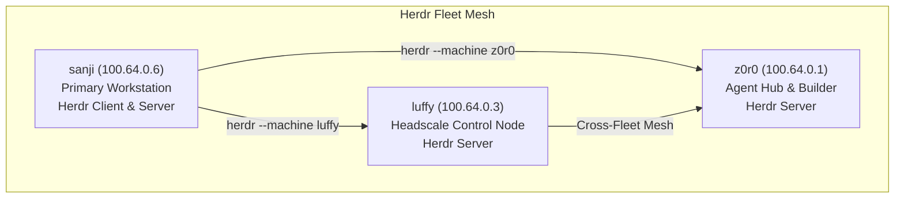

# 🐑 Herdr Fleet Workspace Management Guide

Documentation for multi-machine persistent workspace management for AI coding agents and human operators across the Nix Flake Pirates (NFP) fleet.

---

## 🌐 Fleet Topology & Integration

Herdr (`programs.herdr.enable = true`) runs headless servers and interactive clients across all fleet machines over the Tailscale encrypted mesh:



### 1. Registered Machines
All machines authenticate with mutual ED25519 public keys and strict host-key verification:

| Node Name | Tailnet Address | Herdr ID | Status |
|---|---|---|---|
| **sanji** | `100.64.0.6` | Local Controller | Active |
| **luffy** | `100.64.0.3` | `41912e5dcd29ebd8091b4c8dddc7e75f` | Reachable |
| **z0r0** | `100.64.0.1` | `230b5d359beba0b2f2399146b43dcfff` | Reachable |

---

## 🛠️ Remote Agent Management & Commands

### 1. Verification & Status Checks
```bash
# List all registered remote machines
herdr machine list

# Check machine reachability
herdr machine status
```

### 2. Remote Workspace & Agent Querying
Inspect remote agent activities and workspace trees on peer nodes without opening interactive SSH sessions:

```bash
# Query active workspaces on luffy
herdr --machine luffy workspace list

# Query active workspaces and tabs on z0r0
herdr --machine z0r0 workspace list
```

### 3. Remote Interactive Attachment
Attach directly into a remote machine's persistent agent session with local keybindings:
```bash
# Attach to default session on luffy
herdr --remote t0psh31f@100.64.0.3

# Attach to named session on z0r0
herdr --remote t0psh31f@100.64.0.1 --session agent-cluster
```

### 4. Machine Lifecycle Commands
```bash
# Register a new machine
herdr machine add <user>@<host> --label <name>

# Re-authenticate and verify connectivity
herdr machine reconnect <name>

# Rename or disable a machine
herdr machine rename <old> <new>
herdr machine disable <name>
```
